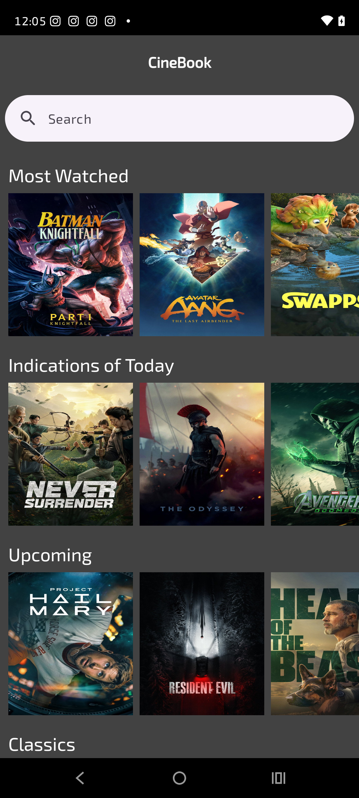
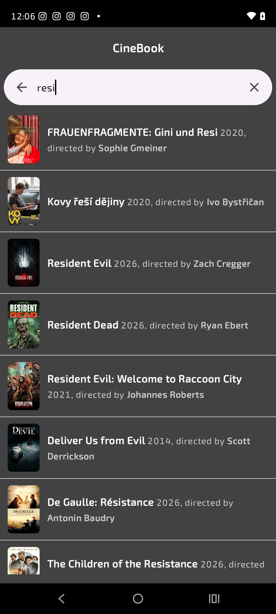
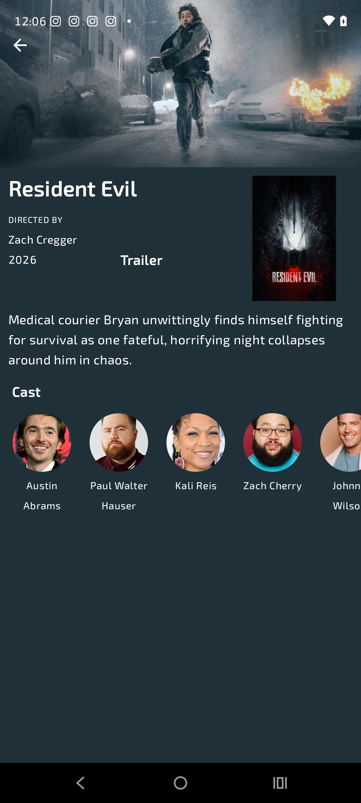
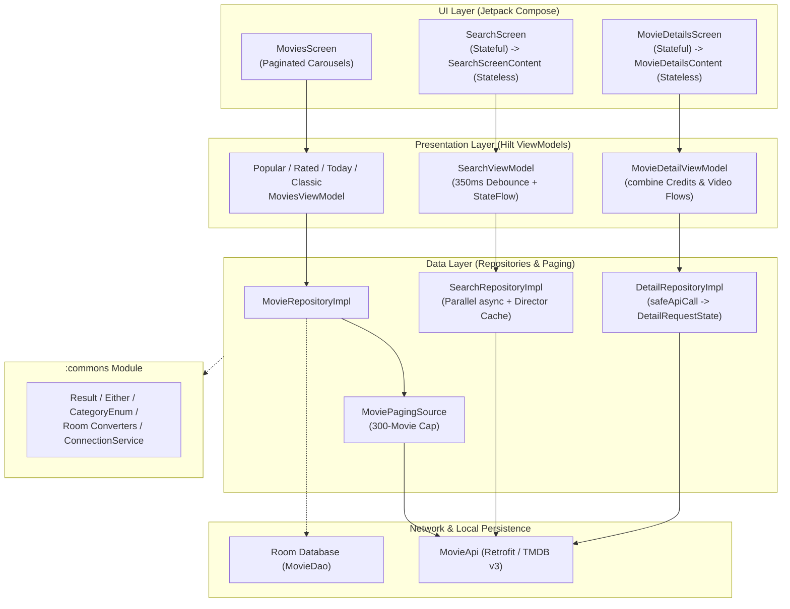
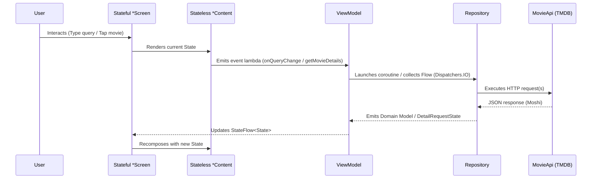
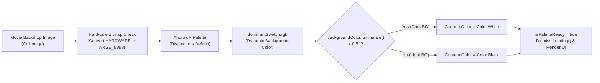

# CineBook (Movie Application)
[](https://github.com/SamuelRmos/MovieApplication/actions/workflows/android_ci.yml)

**CineBook** is a modern Android application built entirely with **Jetpack Compose** that lets users discover popular, top-rated, upcoming, and classic movies, search titles in real time with director enrichment, and explore rich movie detail screens with dynamic backdrop color extraction and cast/trailer integration powered by **The Movie Database (TMDB) v3 API**.

---

## Screenshots

| Home Screen (`MoviesScreen`) | Search Screen (`SearchScreen`) | Movie Details (`MovieDetailsScreen`) |
| :---: | :---: | :---: |
|  |  |  |
| Paginated horizontal carousels for *Most Watched*, *Indications of Today*, *Upcoming*, and *Classics* with shimmer loading and pull-to-refresh. | Real-time debounced search (`350ms`) with concurrent director resolution, release year, and poster thumbnails. | Dynamic `Palette` background & contrast-aware typography, director/year metadata, YouTube trailer link, and circular cast carousel. |

---

## Tech Stack

- **Language:** Kotlin (Coroutines, `Flow`, `StateFlow`)
- **UI Toolkit:** Jetpack Compose & Material 3
- **Image Loading & Dynamic Theming:** Landscapist Coil (`CoilImage`) + AndroidX Palette (`palette-ktx`)
- **Pagination:** AndroidX Paging 3 (`Pager`, `PagingSource`, `LazyPagingItems`)
- **Dependency Injection:** Dagger Hilt (`@HiltViewModel`, `SingletonComponent`)
- **Networking & Serialization:** Retrofit 2, OkHttp 3, Moshi (`@JsonClass(generateAdapter = true)`)
- **Local Persistence:** Room Database (`AppDataBase`, `MovieDao`)
- **Logging:** Timber
- **Testing:** JUnit 4, MockK, OkHttp `MockWebServer`, AndroidX Paging Testing
- **Static Analysis & Formatting:** Ktlint & Android Lint

---

## Project Architecture

CineBook is structured as a multi-module Android project (`:app` and `:commons`) following **MVVM (Model-View-ViewModel)** and **Unidirectional Data Flow (UDF)** principles.

### High-Level Architecture Diagram



### Module Structure

- **`:app` (`com.example.movie`)** — Main application module:
  - `ui/` — Compose screens (`MoviesScreen`, `SearchScreen`, `MovieDetailsScreen`), reusable components (`MovieCard`, `CastRow`, `MovieRowShimmer`, `DimensUtil`), and UI states (`DetailsState`, `DetailRequestState`, `SearchState`).
  - `navigation/` — Single-activity Compose Navigation graph (`NavGraph`, `Screens`, `Actions`).
  - `viewmodel/` — `@HiltViewModel` state holders managing screen flows and lifecycle-aware coroutines.
  - `repository/` & `data/paging/` — Data orchestration, concurrent API enrichment, and Paging 3 sources.
  - `network/` & `model/` — Retrofit `MovieApi` service and Moshi data models.
  - `di/` — Hilt modules (`ApiModule`, `RepositoryModule`, `PersistenceModule`).
- **`:commons` (`com.example.commons`)** — Shared cross-cutting utilities (`Either`, `Result`, `CategoryEnum`, Room `TypeConverter`s, `ConnectionService`, and `MovieLog`).

---

## Screen Architecture & Data Flows

### 1. Stateful vs. Stateless Composable Split
Every feature screen separates state collection from UI rendering:
- **Stateful Screen (`*Screen`):** Obtains the `@HiltViewModel`, collects `StateFlow` via `collectAsState()`, coordinates side effects (`LaunchedEffect`), and wires navigation callbacks.
- **Stateless Content (`*Content`):** Accepts immutable state (`DetailsState`, `SearchState`) and event lambdas, making UI components deterministic and previewable via `@Preview` without Hilt or network dependencies.



### 2. Core Feature Flows
1. **Home Carousels (`MovieRepository` -> `*MoviesViewModel`):**
   - Wraps TMDB discovery endpoints in a Paging 3 `Pager(PagingConfig(pageSize = 20))` backed by `MoviePagingSource` (enforcing a 300-movie pagination limit).
   - Each carousel row independently renders `MovieRowShimmer` while loading, `ErrorRow` on failure, and a horizontal `LazyRow` of `MovieCard` items with pull-to-refresh.
2. **Real-Time Search with Parallel Director Enrichment (`SearchRepository` -> `SearchViewModel`):**
   - `SearchViewModel` debounces user keystrokes by `350ms`, cancels in-flight searches on new input, and immediately resets state when cleared.
   - `SearchRepositoryImpl` fetches matching movies from `/3/search/movie` and concurrently resolves each movie's director (`job == "Director"`) using `coroutineScope` + `async` against `/3/movie/{id}/credits`, caching results in a thread-safe `ConcurrentHashMap<Int, String>`.
3. **Concurrent Movie Details (`DetailRepository` -> `MovieDetailViewModel`):**
   - `MovieDetailViewModel` combines `getCreditsMovie(id)` and `getVideosMovie(id)` concurrently via `combine(creditsFlow, videoFlow, ::mergeStates)` so cast, director, and YouTube trailer keys arrive in parallel without blocking one another.

---

## UI & Design System



- **Cinema-First Dark Theme (`theme/`):**
  - Built on a high-contrast dark palette (`colorPrimary = #000000`, `colorAccent = #FF0B04`, `colorBackground = #424242`, `colorText = #FFFFFF`) paired with the custom `Roboto` font family.
- **Dynamic Palette Extraction & Contrast Adaptation (`MovieDetailsScreen.kt`):**
  - Extracts the predominant color (`dominantSwatch`) from the movie's backdrop image off the main thread (`Dispatchers.Default`), safely converting `Bitmap.Config.HARDWARE` bitmaps to `ARGB_8888` first.
  - Computes background luminance (`backgroundColor.luminance()`) and automatically switches text and icon tint between `Color.White` (`luminance < 0.5f`) and `Color.Black` (`luminance >= 0.5f`) for optimal readability.
  - Keeps the full-screen `Loading()` indicator visible until both network fetches (`!requestState.isLoading`) and palette extraction (`isPaletteReady`) complete.
- **Centralized Resource System (`dimens.xml`, `strings.xml`, `DimensUtil.kt`):**
  - All spacing, sizes, and typography scales are defined in `app/src/main/res/values/dimens.xml` (`dimen_*`, `text_size_*`) and resolved in Compose through shared helpers in `DimensUtil.kt` (`dimensionResource` and `textSizeResource`).

---

## Pre-requisites & Setup

1. Obtain a **TMDB API Key** from [The Movie Database](https://www.themoviedb.org/documentation/api).
2. Export your key as an environment variable (`API_KEY`) or configure it in your local properties:
   ```powershell
   $env:API_KEY="YOUR_TMDB_API_KEY"
   ```
3. Build and run tests using the Gradle wrapper:
   ```powershell
   # Assemble debug APK
   .\gradlew.bat assembleDebug

   # Run unit tests
   .\gradlew.bat testDebugUnitTest

   # Run Ktlint checks
   .\gradlew.bat ktlintCheck
   ```

---

## Follow Me

[](https://twitter.com/SamuelRamos_MG)
&nbsp;&nbsp;&nbsp;|&nbsp;&nbsp;&nbsp;
[](https://www.linkedin.com/in/samuelramos-sjr/)
